# Práctica 4. Gestión Avanzada de Ramas y Resolución de Conflictos

## 1. Introducción

### 1.1 Crear el directorio del proyecto

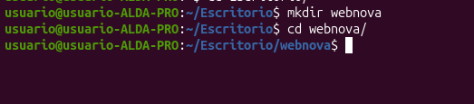

### 1.2 Configurar la rama predeterminada e inicializar el repositorio

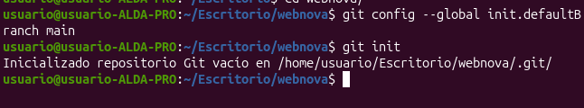

### 1.3 Crear el archivo base `index.html`

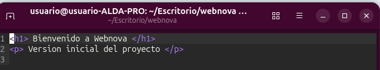

### 1.4 Primer commit (C1)

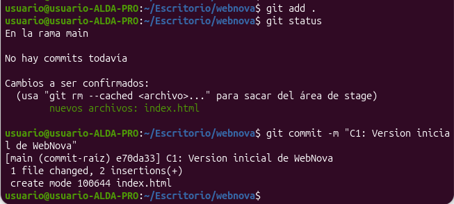

---

## 2. Desarrollo del proyecto

### 2.1 Creación de las ramas de características

Comprobación de que las ramas existen y de que seguimos en `main`:

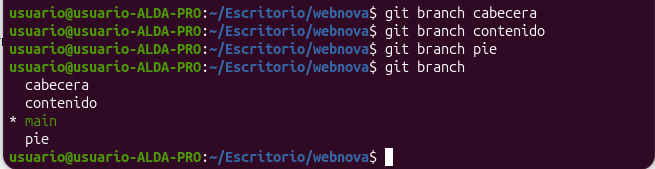

### 2.2 Desarrollo en la rama `cabecera`

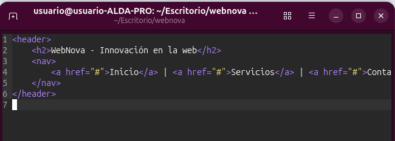

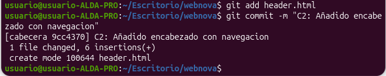

### 2.3 Desarrollo en la rama `contenido`

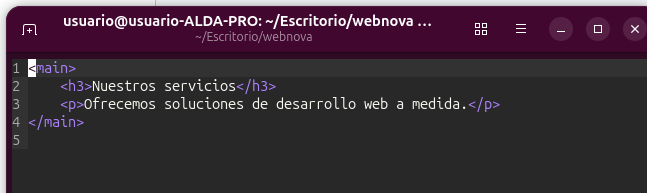

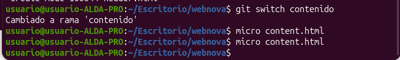

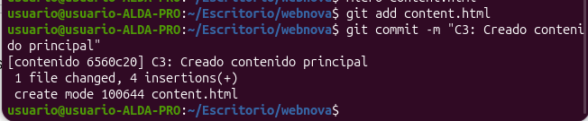

### 2.4 Desarrollo en la rama `pie`

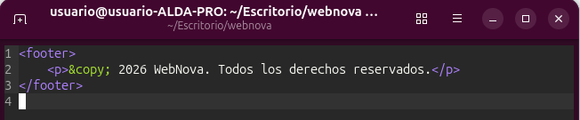

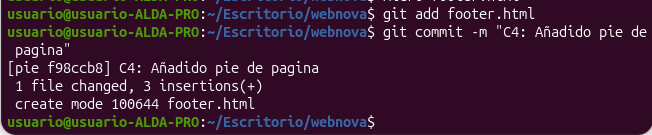

---

### 2.5 Volver a `main` y fusionar las ramas

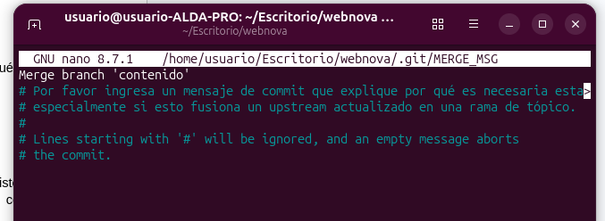

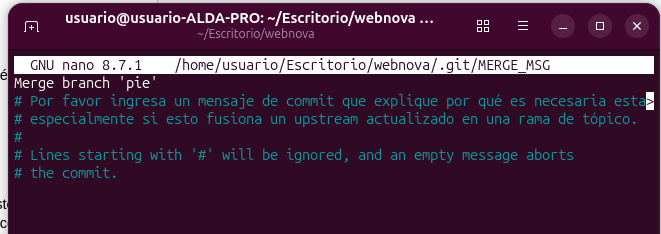

### 2.6 Unificar el código en `index.html`

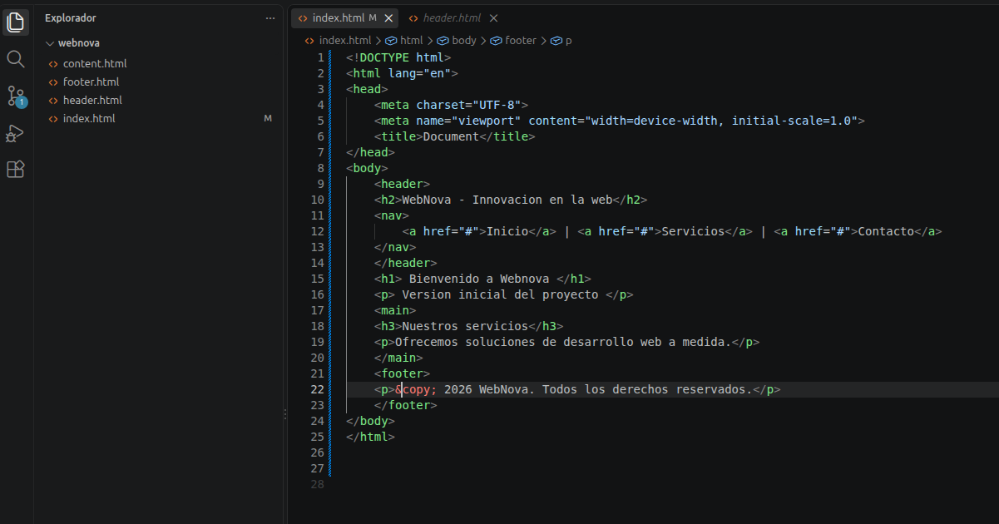

### 2.7 Commit de consolidación (C5)

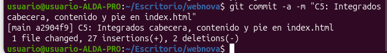

### 2.8 Limpieza: eliminar las ramas de desarrollo

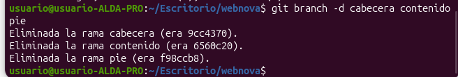

---

## PARTE 3: Provocando y resolviendo un conflicto

### 3.1 La rama de rediseño

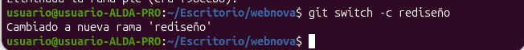

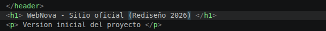

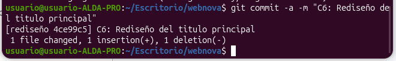

### 3.2 Trabajo divergente en `main`

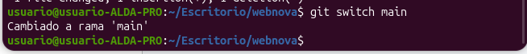

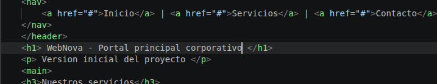

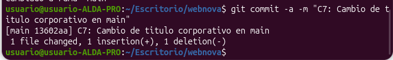

### 3.3 La fusión y el conflicto

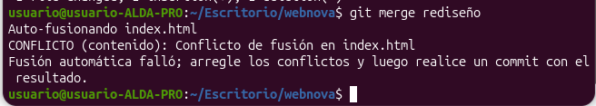

### 3.4 Resolución del conflicto

**Estado del archivo con las marcas de conflicto:**

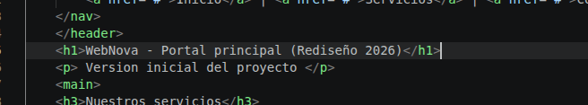

**Finalizar la fusión:**

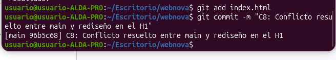

---

## PARTE 4: Visualización del historial

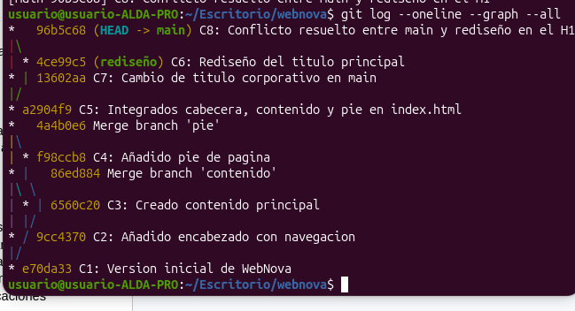

---

## 4. Reflexión teórica

### 4.1 ¿Por qué ocurrió el conflicto en la PARTE 3 y por qué no ocurrió en la PARTE 2?

En la PARTE 2 no hubo conflicto porque cada rama modificó un archivo distinto header.html, content.html y footer.html. Al fusionar, Git pudo combinar los cambios automáticamente, ya que ninguna rama tocaba las mismas 
líneas de un mismo archivo. Además, que ni siquiera requiere combinar contenido.
En la PARTE 3 el conflicto apareció porque las dos ramas main y rediseño modificaron la misma línea <h1> del mismo archivo index.html a partir de un ancestro común, con valores distintos. Git no puede decidir 
automáticamente cuál de las dos versiones es la correcta, así que detiene la fusión, marca el conflicto en el archivo y delega la decisión en el desarrollador.

### 4.2 Al ejecutar git switch main en la PARTE 3.2, ¿qué ocurrió con los archivos de tu directorio de trabajo?

Git actualizó el directorio de trabajo para reflejar el último commit de la rama main. Como index.html en rediseño tenía el <h1> modificado (WebNova - Sitio oficial (Rediseño 2026)), al cambiar a main el archivo volvió 
automáticamente a su versión anterior, con el título original de main. Los cambios de rediseño no se pierden: quedan guardados en su commit (C6), y Git solo reescribe el contenido del directorio para que coincida con la 
rama activa.

---

## 5. Conclusiones

Con esta práctica se ha trabajado la creación y navegación de ramas con git switch, la identificación y resolución manual de un conflicto de fusión y la visualización del historial con git log --oneline --graph --all, 
manteniendo un historial estructurado y limpio.
